# litmar

`litmar` es una herramienta de Python para reunir literatura científica de varias
fuentes en una sola biblioteca. Busca en servicios con API pública, convierte
cada resultado a un modelo común (`Articulo`), elimina duplicados por DOI y
exporta el conjunto a BibTeX para usarlo en LaTeX o en un gestor de referencias.

Se puede usar desde la línea de comandos o como librería.

## Instalación

Requiere Python 3.12 o superior y [uv](https://docs.astral.sh/uv/).

```bash
uv sync                 # librería y CLI (en desarrollo incluye también la interfaz web)
uv sync --extra ui      # fuera del grupo dev: añade Streamlit para `litmar ui`
uv run litmar --help
```

Con pip: `pip install .` o, con la interfaz web, `pip install '.[ui]'`.

## Configuración

Las claves y datos de cada fuente se leen de variables de entorno. Lo más cómodo
es un fichero `.env` en el directorio desde el que ejecutas `litmar`:

```bash
cp .env.example .env    # y rellena lo que necesites
```

Para buscar todo es opcional: sin configurar nada funcionan OpenAlex, Crossref,
Europe PMC, arXiv y PANGAEA. Para resumir con un modelo de lenguaje hacen falta
`LITMAR_MODELO` y la clave de su proveedor. `.env.example` explica cada variable:

| Variable | Fuente | Para qué |
| --- | --- | --- |
| `OPENALEX_API_KEY` | OpenAlex | Presupuesto diario propio en lugar del compartido |
| `CROSSREF_MAILTO` | Crossref | Entrar en el *polite pool*, con límites más altos |
| `ZOTERO_USER_ID` o `ZOTERO_GROUP_ID` | Zotero | Biblioteca en la que buscar (sin ella, Zotero no aparece) |
| `ZOTERO_API_KEY` | Zotero | Solo para bibliotecas privadas |
| `LITMAR_MODELO` | Modelo de lenguaje | `proveedor:modelo`, p. ej. `google_genai:…` o `anthropic:…` |
| `GOOGLE_API_KEY` o `ANTHROPIC_API_KEY` | Modelo de lenguaje | La clave del proveedor elegido |
| `LITMAR_LLAMADAS_POR_MINUTO` | Modelo de lenguaje | Límite de llamadas (10 por defecto, para el plan gratuito de Gemini; 0 = sin límite) |

`.env` no se sube a git. Las variables que ya estén definidas en el entorno
tienen prioridad sobre las del fichero.

## Interfaz web

```bash
uv run litmar ui
```

Abre en el navegador una página con dos pestañas.

**Búsqueda**:
- escribir la búsqueda, elegir las fuentes y el número de resultados por fuente;
- ver una tabla con año, citas, autores, título y enlace al DOI, sin duplicados
  entre fuentes;
- descargar los resultados en BibTeX o en CSV (el CSV se abre bien en Excel).

**Revisión** (lo mismo que `litmar revisar`):
- escribir una pregunta de investigación y elegir el modo (flujo o agente), las
  fuentes y el número de artículos;
- ver cada paso en vivo mientras trabaja (los nodos del flujo o las llamadas del
  agente);
- leer el informe con los DOI citados como enlaces a doi.org y descargarlo junto
  con el BibTeX de lo citado.

Si falta `LITMAR_MODELO` o la clave de su proveedor, la pestaña dice qué línea
añadir al `.env` y el botón «Revisar» queda desactivado. La aprobación de
búsquedas (`--aprobar`) solo está en la terminal.

Si una fuente falla, se muestra el error y se siguen viendo los resultados de las
demás. Las opciones adicionales se pasan a Streamlit, por ejemplo
`uv run litmar ui --server.port 8600`. `litmar ui` desactiva las estadísticas de
uso que Streamlit envía por defecto. La primera vez, Streamlit pide un correo para
su boletín: es opcional y basta con pulsar Intro para saltarlo.

## Línea de comandos

```bash
# Buscar en OpenAlex (la fuente por defecto) y ver una tabla de resultados
uv run litmar buscar "microplastics Mediterranean" --n 5

# Varias fuentes, solo desde 2020, y exportar directamente a BibTeX
uv run litmar buscar "posidonia carbon" --fuente openalex,europepmc \
    --desde 2020 --bibtex refs.bib

# Consultar hasta 30 artículos y guardar todos sus metadatos
uv run litmar buscar "machine learning" -n 30 --guardar biblioteca.json

# Ampliar la misma biblioteca con otra búsqueda
uv run litmar buscar "deep learning" -n 20 --guardar biblioteca.json

# Generar referencias para LaTeX u otras herramientas compatibles
uv run litmar exportar biblioteca.json --bibtex referencias.bib
```

- **Combinar resultados:** si el JSON ya existe, los resultados se combinan con
  los artículos guardados. Los DOI se normalizan y, ante duplicados, se conserva
  el artículo original.
- **Guardado seguro:** el JSON se reemplaza de forma atómica. Un JSON inválido se
  rechaza sin sobrescribirlo.
- **Salida:** una tabla con año, citas, autores y título, ajustada al ancho de
  la terminal:
  ```
  AÑO   CITAS  AUTORES            TÍTULO
  2012    698  Collignon et al.   Neustonic microplastic and zooplankton in the North…
  2015    438  Fossi et al.       Fin whales and microplastics: The Mediterranean Sea…
  ```
- **`--fuente`:** una o varias, separadas por comas: `openalex` (por defecto),
  `crossref`, `europepmc`, `arxiv`, `pangaea` y `zotero`. Los resultados se
  juntan sin duplicar DOI. Si una fuente falla, se avisa y se sigue con las demás;
  si fallan todas, es un error y no se guarda nada.
- **`-n` / `--n`:** máximo de artículos válidos **por fuente**. Puede haber menos
  si no hay suficientes resultados con DOI, título, año y autores.
- **`--desde AÑO`:** solo artículos publicados ese año o después. Se pide como
  filtro a cada API (salvo Zotero, que no lo admite) y además se comprueba el año
  de cada resultado.
- **`--bibtex`:** exporta los resultados de esa búsqueda. Para exportar una
  biblioteca acumulada con `--guardar`, usa `litmar exportar`.
- **Exportar:** la exportación reemplaza el fichero BibTeX de destino si ya
  existe.
- **Códigos de salida:** los errores operativos (red, HTTP, ficheros) devuelven
  1 y los argumentos inválidos, 2.
- **`python -m`:** la CLI también se ejecuta con `uv run python -m litmar`.

La clave de OpenAlex se lee de `OPENALEX_API_KEY`, del `.env` (ver
[Configuración](#configuración)) o del entorno:

```bash
# bash / zsh (macOS, Linux)
export OPENALEX_API_KEY="tu-clave"
uv run litmar buscar "bibliometrics" -n 5
```

```powershell
# PowerShell (Windows)
$env:OPENALEX_API_KEY = "tu-clave"
uv run litmar buscar "bibliometrics" -n 5
```

## API HTTP

litmar también se expone como API con FastAPI. Es otro punto de entrada, como la
CLI y la interfaz web: las tres usan las mismas funciones de búsqueda y revisión.

```bash
uv run litmar servir                    # http://127.0.0.1:8000
uv run litmar servir --host 0.0.0.0 --puerto 8000 --recargar
```

La documentación interactiva está en <http://127.0.0.1:8000/docs> y el contrato
en formato JSON, en `/openapi.json`. `--recargar` reinicia el servidor al cambiar
el código; `--host` y `--puerto` admiten los valores habituales de uvicorn.

| Ruta | Qué hace | Códigos |
| --- | --- | --- |
| `GET /salud` | Comprueba que el servidor responde | 200 |
| `GET /fuentes` | Lista las fuentes y cuáles están configuradas | 200 |
| `GET /buscar` | Busca en varias fuentes, sin duplicar DOI | 200, 422, 502 |
| `POST /revisiones` | Devuelve informe y BibTeX de una pregunta | 200, 422, 502, 503 |

- **`GET /buscar`**: `consulta` (obligatoria), `fuente` (repetible; por defecto
  `openalex`), `n` (1–50, por defecto 10) y `desde` (año mínimo, 1900–2100).
  Acepta tanto ids (`europepmc`) como nombres canónicos (`Europe PMC`). Si falla
  una fuente, la respuesta sigue siendo 200 y el error aparece en `errores` y
  `fuentes_fallidas`; solo si fallan todas es 502.

  ```bash
  curl "http://127.0.0.1:8000/buscar?consulta=posidonia&fuente=openalex&fuente=europepmc&n=2&desde=2020"
  ```

- **`POST /revisiones`**: cuerpo JSON con `pregunta` (obligatoria), `modo`
  (`flujo`, por defecto, o `agente`), `fuente` (lista), `n` (≤ 10) y `desde`.
  Devuelve `informe` en Markdown, `bibtex` de lo citado, `citados` y `avisos`.
  **No guarda archivos**: para eso está `litmar revisar`. Es síncrona y puede
  tardar varios minutos; la web debe mostrar que está esperando. Sin aprobación
  interactiva. Si falta `LITMAR_MODELO` o su clave, responde 503 con un mensaje
  que dice qué añadir al `.env`.

  ```bash
  curl -X POST http://127.0.0.1:8000/revisiones \
    -H 'Content-Type: application/json' \
    -d '{"pregunta": "¿Qué papel tiene la posidonia?", "modo": "flujo"}'
  ```

- **Sin autenticación**: no hay token ni `401`. Escucha en `127.0.0.1` y está
  pensada para uso interno, sirviendo la web desde el mismo origen. Antes de
  exponerla a Internet hacen falta autenticación, límites de uso y HTTPS.

Los modelos de entrada y salida son Pydantic, así que `/docs` muestra los
ejemplos y los errores de validación (422) sin escribir una línea de cliente.

## Web

La propia API sirve una página en <http://127.0.0.1:8000/> con el mismo
comando; no hay que levantar otro servidor:

```bash
uv run litmar servir
```

Es un único fichero, `src/litmar/web/index.html`, con el CSS y el JavaScript
dentro: sin npm, sin compilación y sin ficheros estáticos extra. `GET /` lo lee
del paquete, así que también funciona con litmar instalado.

- **Búsqueda:** escribe la consulta, marca fuentes (las obtiene de `GET
  /fuentes`), elige `n` y `desde`, y pulsa «Buscar». La tabla trae año, citas,
  autores, título y el DOI enlazado a doi.org. Si alguna fuente falla, se ven
  sus resultados y un aviso con el motivo; si fallan todas, un error claro.
- **Revisión:** escribe la pregunta, elige modo, fuentes, `n` y `desde`, y pulsa
  «Revisar». Antes avisa de que **una revisión tarda varios minutos** y mientras
  espera deja el botón desactivado con el estado «Revisando…». Al terminar
  muestra el informe con los DOI convertidos en enlaces y un botón que descarga
  el BibTeX en el navegador; el servidor no escribe ningún fichero.
- La página solo llama a `/fuentes`, `/buscar` y `/revisiones` con **rutas
  relativas**: no lleva la dirección del servidor escrita y no necesita CORS,
  porque la web y la API comparten origen. Para ver qué pide y qué devuelve,
  abre las herramientas del navegador (F12 > Red).

## Docker

El `Dockerfile` construye una imagen con Python 3.12 slim y uv fijado a la
versión que generó `uv.lock`:

```bash
docker build -t litmar .
docker run --rm --env-file .env -p 8000:8000 litmar
```

- **Caché:** primero se copian `uv.lock`, `pyproject.toml` y `README.md` y se
  instalan las dependencias; el código entra después. Un cambio en `src/` no
  reinstala las librerías.
- **Sin desarrollo:** `uv sync --locked --no-dev` deja fuera pytest, ruff y
  Streamlit (el extra `ui` no se pide). `uv.lock` garantiza las mismas versiones.
- **Secretos:** `.env` no se copia a la imagen (`.dockerignore` lo excluye junto
  con `.git`, `.venv`, cachés, `tests/` y `docs/`). Las variables se pasan al
  arrancar con `--env-file .env`.
- **Seguridad:** el servidor corre con el usuario `app`, no root, y ejecuta
  directamente el script de `.venv/bin` para que uv no intente reescribir el
  entorno al arrancar.
- La API escucha en `0.0.0.0:8000` dentro del contenedor. Para ver la web y la
  documentación: <http://localhost:8000/> y <http://localhost:8000/docs>.

### Con docker compose

Con `compose.yaml` se levantan la API y una web nginx con un solo comando. Copia
antes `.env.example` a `.env` (puede quedar vacío):

```bash
docker compose up --build        # construir y arrancar (añade -d para segundo plano)
docker compose ps                # estado de los dos servicios
docker compose logs -f api       # logs de la API en vivo
docker compose logs -f web       # logs de nginx
docker compose down              # parar y quitar los contenedores
```

La web está en <http://localhost:8080> y la documentación de la API sigue en
<http://localhost:8000/docs>. nginx sirve `src/litmar/web` en `/` y reenvía
`/salud`, `/fuentes`, `/buscar`, `/revisiones`, `/docs` y `/openapi.json` al
servicio `api` por su nombre, con tiempo de espera de 10 minutos para las
revisiones. La configuración está en `nginx/default.conf`, montada solo lectura.
Si la API se cae, nginx devuelve 502 y la web lo muestra como error.

## Revisión de literatura con un modelo de lenguaje

`litmar revisar` responde a una pregunta de investigación con un informe que
solo cita artículos reales, y el BibTeX de lo citado. Necesita `LITMAR_MODELO` y
la clave de su proveedor en el `.env` (ver [Configuración](#configuración)).

```bash
uv run litmar revisar "¿Cómo afecta el calentamiento a las praderas de Posidonia oceanica?"
```

```
> planificar         3 consultas
> buscar             50 artículos
> resumir_articulos  M resúmenes
> filtrar            6 seleccionados
> sintetizar         informe (5 citas)
> verificar_citas    ok
Informe guardado en ejemplos/revisiones/2026-11-18_1530_como-afecta-el-calentamiento-a-las-praderas-de/revision.md.
5 artículos citados exportados a ejemplos/revisiones/2026-11-18_1530_como-afecta-el-calentamiento-a-las-praderas-de/revision.bib.
```

Es un flujo fijo de LangGraph (`src/litmar/flujo.py`) con seis pasos. Tres usan
el modelo y tres son código normal:

```mermaid
flowchart LR
    START([START]) --> planificar
    planificar["LLM · planificar<br/>Convierte la pregunta en 2-3 búsquedas"] --> buscar
    buscar["CÓDIGO · buscar<br/>Consulta las fuentes"] --> resumir_articulos
    resumir_articulos["LLM · resumir_articulos<br/>Puntúa la relevancia de los candidatos"] --> filtrar
    filtrar["CÓDIGO · filtrar<br/>Selecciona los N con mejor puntuación"] --> sintetizar
    sintetizar["LLM · sintetizar<br/>Escribe la síntesis citando por DOI"] --> verificar_citas
    verificar_citas["CÓDIGO · verificar_citas<br/>¿Cada DOI citado está entre los seleccionados?"]
    verificar_citas -- "citas inventadas: reescribir (máx. 2)" --> sintetizar
    verificar_citas -- "ok" --> END([END])
```



- **Selección:** combina 70 % de relevancia (1–5) con 30 % de una puntuación
  de citas anualizadas. Las citas se dividen por los años desde la publicación y
  se ajustan con `1 + 4 × tasa / (1 + tasa)`, donde
  `tasa = citas / max(1, año_actual - año_publicación + 1)`. Si no hay recuento,
  se usa solo la relevancia.
  La CLI avisa qué artículos seleccionados no tienen el dato. Para puntuar todos
  los candidatos con resumen, el flujo puede hacer más llamadas al modelo que
  el número final de artículos seleccionados.
- **`verificar_citas`** comprueba con código que cada DOI citado está entre los
  artículos seleccionados. Si alguno no está, el modelo reescribe la síntesis (como
  mucho 2 veces); si después sigue habiendo DOI inventados, se sustituyen por
  «[cita no verificada]» y se avisa. Ningún DOI sin comprobar llega al informe ni
  al BibTeX.
- **Dónde se guarda:** cada revisión, en su propio subdirectorio de
  `ejemplos/revisiones/`, con la fecha, la hora y la pregunta en el nombre. Una
  revisión nunca pisa a otra (si coincide el nombre, se añade `-2`) y una que
  falla no deja carpeta. `ejemplos/revisiones/` está en el `.gitignore`.
  `--informe` y `--bibtex` permiten elegir otra ruta.
- **El informe** (`revision.md`) incluye la pregunta,
  las búsquedas, la síntesis, las referencias (las escribe el código a partir de
  lo citado, no el modelo) y los avisos (fuentes que fallaron, resúmenes que no
  se pudieron hacer).
- **El BibTeX** (`revision.bib`): solo los artículos citados.
- **`--fuente`** (por defecto `openalex,europepmc`), **`-n`** (artículos que se
  resumen: 6 por defecto, 10 como máximo) y **`--desde AÑO`**.
- **Coste:** una llamada para planificar, una por artículo y de 1 a 3 para la
  síntesis. Con el límite de 10 llamadas por minuto, en torno a minuto y medio.

### Modo agente

`--modo agente` responde a la misma pregunta con un agente de
[Deep Agents](https://docs.langchain.com/oss/python/deepagents/overview): en
lugar de pasos fijos, el modelo decide qué buscar y cuándo parar. Guarda el
informe y el BibTeX con el mismo formato que el flujo, para poder compararlos.

```bash
uv run litmar revisar "¿Cómo afecta el calentamiento a las praderas de Posidonia oceanica?" --modo agente
```

```
[~] Buscar efectos de olas de calor marinas en Posidonia oceanica (OpenAlex)
[ ] Buscar efectos fisiológicos del estrés térmico (Europe PMC)
[ ] Escribir el informe en /informe.md
→ task(buscador): Busca en OpenAlex artículos sobre el efecto de las olas de calor…
    · buscar_articulos(«Posidonia oceanica marine heatwave mortality», OpenAlex, n=10)
→ write_file(informe.md)
[x] 3/3 tareas
```

- **Qué puede hacer**: el agente principal planifica con una lista de tareas,
  encarga las búsquedas a un subagente `buscador` y escribe el informe en un
  fichero virtual (vive en memoria, no en el disco). El buscador solo tiene
  `buscar_articulos` y `listar_fuentes`, limitadas a las fuentes de `--fuente`.
  Nada escribe en el disco ni ejecuta código.
- **Límites en el código**: 25 llamadas al modelo para el agente principal, 8
  por encargo al buscador y 12 búsquedas en total. Si el agente llega a su
  límite, el informe dice hasta dónde llegó (su lista de tareas).
- **Citas comprobadas**: cada DOI citado se busca entre los artículos que
  devolvieron las búsquedas; los demás se marcan como «[cita no verificada]».
  El informe termina con «Lo que no se encontró».
- **`--aprobar`**: antes de cada búsqueda, el agente se detiene y pregunta:
  ```
  ? ¿Buscar «posidonia warming» en Europe PMC (n=5)? [S/n/e(ditar)]
  ```
  `n` la rechaza (el agente lo sabe y sigue sin ella) y `e` permite cambiar la
  consulta o la fuente.
- **Coste y tiempo**: más llamadas que el flujo (en la prueba, 3 encargos y 9
  búsquedas, casi 2 minutos con el límite de 10 llamadas por minuto).

### Herramientas para un modelo

`litmar.herramientas` ofrece las fuentes como herramientas de LangChain, para
que un modelo (o un agente) las pida:

- **`buscar_articulos(consulta, fuente, n)`**: una sola herramienta para todas
  las fuentes. Devuelve título, año, DOI, citas y el principio del resumen.
  Como mucho 10 resultados (límite en el código). Si la fuente falla o no
  existe, devuelve un texto que empieza por «Error», no una excepción. Con
  PANGAEA avisa de que son datos, no artículos.
- **`listar_fuentes()`**: las fuentes disponibles y qué contiene cada una.

```python
from litmar.herramientas import HERRAMIENTAS, buscar_articulos

print(buscar_articulos.invoke({"consulta": "posidonia carbon", "fuente": "europepmc", "n": 3}))
modelo_con_herramientas = modelo.bind_tools(HERRAMIENTAS)
```

## Uso desde Python

```python
from litmar import Biblioteca
from litmar.fuentes import OpenAlex, Pangaea

biblioteca = Biblioteca()
with OpenAlex() as openalex, Pangaea() as pangaea:
    for articulo in openalex.buscar("ocean acidification", n=20):
        biblioteca.agregar(articulo)
    for dataset in pangaea.buscar("ocean acidification", n=20):
        biblioteca.agregar(dataset)

biblioteca.guardar("biblioteca.json")
recuperada = Biblioteca.cargar("biblioteca.json")
recuperada.exportar_bibtex("referencias.bib")
```

- **`Articulo`:** registro inmutable con título, autores, año, DOI, revista,
  resumen y número de citas, que puede ser `None` si la fuente no lo proporciona.
  El DOI se normaliza (sin `https://doi.org/`, en minúsculas) y actúa como identidad.
- **`Biblioteca`:** colección ordenada sin duplicados.
  - `agregar` devuelve `False` si el DOI ya estaba.
  - `obtener(doi)` admite el DOI en cualquier formato.
  - `guardar` y `cargar` leen y escriben el JSON.
  - `a_bibtex` y `a_csv` devuelven el texto exportado.
- **Fuentes:** todas heredan de `Fuente` e implementan
  `buscar(consulta, n) -> list[Articulo]`. Reintentan solas ante errores de red,
  `429` y `5xx`, con espera exponencial y respetando `Retry-After`.

El JSON es una lista de artículos con `title`, `authors`, `year`, `doi`,
`journal`, `abstract` y `citations`. Conserva los caracteres Unicode y el orden
de inserción. Al cargar, `abstract` y `citations` son opcionales y toman los
valores `""` y `null`.

### Resumen estructurado con un modelo de lenguaje

`resumir(articulo, pregunta, modelo)` le pide al modelo un `ResumenArticulo`
(objetivo, método, hallazgos, relevancia de 1 a 5 para la pregunta y
limitaciones) con `with_structured_output`. Así la respuesta llega como un
objeto Pydantic ya validado, no como texto. Si el artículo no tiene resumen,
devuelve `None` sin llamar al modelo. Sirve cualquier modelo de chat de
LangChain; `crear_modelo()` crea el que diga `LITMAR_MODELO`, con el límite de
llamadas por minuto, y si falta algo en el `.env` lanza `ErrorDeConfiguracion`
con un mensaje que dice qué añadir.

`ejemplos/resumir.py` busca 3 artículos sobre *ocean acidification* y resume
cada uno (`uv run python ejemplos/resumir.py`). Cambia `TEMA` y `PREGUNTA` por
los tuyos, y `LITMAR_MODELO` en el `.env` para comparar modelos.

```python
from dotenv import load_dotenv

from litmar.llm import crear_modelo
from litmar.resumen import resumir

load_dotenv()  # el comando `litmar` lo hace solo; un script propio, no
modelo = crear_modelo()

resumen = resumir(articulo, "¿Cuánto carbono almacena Posidonia?", modelo)
if resumen:
    print(resumen.relevance, resumen.findings)
```

## Fuentes

Todas las fuentes descartan los resultados a los que les falta DOI o autores,
porque `Articulo` los exige.

### OpenAlex

Catálogo abierto de trabajos académicos. La clave de API es opcional:
- **Sin clave:** se comparte un presupuesto diario por IP.
- **Con una clave gratuita** (<https://openalex.org/settings/api>): el
  presupuesto es propio y mayor.

```python
OpenAlex(api_key="...")
```

### Crossref

Metadatos de artículos de revista registrados en Crossref. No necesita clave.

- Solo devuelve artículos de revista, sin libros, capítulos ni datasets.
- Sin identificarse se usa el pool público: 1 petición por segundo.
- Con `mailto`, la búsqueda entra en el *polite pool*, con límites más altos.
  El correo se envía a Crossref en cada petición.

```python
Crossref(mailto="tu@correo.org")
```

### Europe PMC

Repositorio abierto de literatura biomédica y de ciencias de la vida, mantenido
por EMBL-EBI. No necesita clave.

### arXiv

Preprints de física, matemáticas, informática y otras áreas. No necesita clave.

- **Consulta:** se envía como `all:<texto>`. La sintaxis avanzada de arXiv
  (prefijos como `ti:` o `au:`, y `AND`/`OR`/`ANDNOT`) se pasa sin cambios.
- **Pausa entre páginas:** arXiv pide 3 segundos entre peticiones consecutivas,
  y `buscar` los respeta al paginar.
- **DOI:** si el preprint no tiene DOI de revista, se usa el que asigna arXiv
  (`10.48550/arXiv.<id>`).

### Zotero

Búsqueda dentro de una biblioteca de Zotero, personal o de grupo, con la API web
v3.

```python
Zotero(user_id=123456)  # biblioteca personal pública
Zotero(group_id=7890, api_key="...")  # biblioteca de grupo privada
```

- **Identificador:** hay que indicar exactamente uno de `user_id` o `group_id`.
  Son números:
  - el de usuario está en <https://www.zotero.org/settings/keys>;
  - el de grupo, en la URL del grupo.
- **Clave:** solo hace falta si la biblioteca no es pública. Se envía en una
  cabecera, no en la URL.
- **Citas:** Zotero no guarda recuentos de citas, así que `citations` es
  `null` («no disponible»).

### PANGAEA

[PANGAEA](https://www.pangaea.de/) es un repositorio de **datasets** de ciencias
de la Tierra y del medio ambiente. No necesita clave.

- La consulta se busca en su índice público de Elasticsearch y deben aparecer
  todos los términos. Se acepta cualquier texto, incluidas comillas, barras o
  paréntesis.
- Como un dataset no tiene revista, el campo `journal` es siempre `"PANGAEA"`.
- `citations` es `null` («no disponible»): PANGAEA no publica ese dato.
- Los autores llegan como `"Apellido, Nombre"`. Las instituciones conservan su
  nombre completo.
- También se descartan los datasets a los que les falta título o año.
- Elasticsearch no deja pasar del resultado 10 000, así que `buscar` nunca
  devuelve resultados más allá de esa posición.

Al exportar a BibTeX, los datasets aparecen como entradas `@article`, igual que
los artículos.

## Tests

```bash
uv run pytest
uv run ruff check        # errores típicos e imports (con --fix los corrige)
uv run ruff format       # formato común para todo el código
```

Los tests no usan la red ni necesitan claves:
- las fuentes se prueban con `httpx.MockTransport` y respuestas reales guardadas
  en `tests/datos/`;
- también cubren los modelos, la deduplicación, los reintentos, la persistencia
  y el flujo de la CLI hasta la exportación BibTeX;
- la interfaz web se prueba con `streamlit.testing` y fuentes simuladas.
