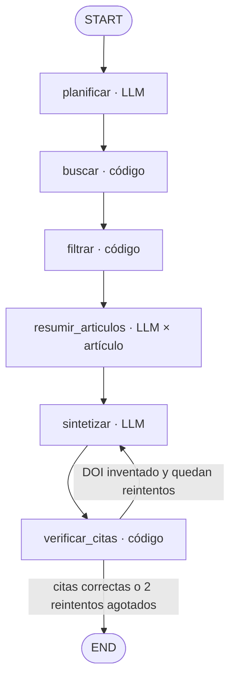
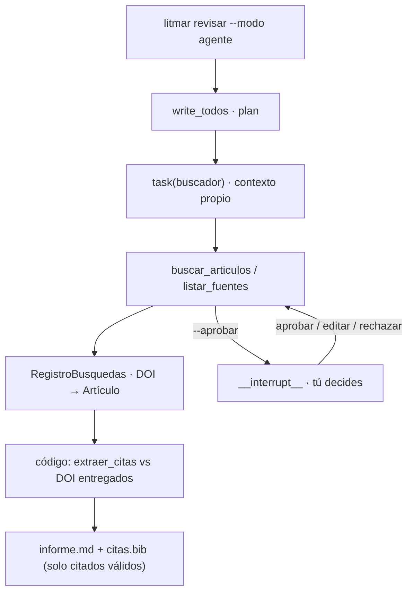

# litmar

`litmar` es una herramienta de Python para reunir literatura científica de varias
fuentes en una sola biblioteca. Busca en servicios con API pública, convierte
cada resultado a un modelo común (`Articulo`), elimina duplicados por DOI y
exporta el conjunto a BibTeX para usarlo en LaTeX o en un gestor de referencias.

Se puede usar desde la línea de comandos o como librería.

## Instalación

Requiere Python 3.12 o superior y [uv](https://docs.astral.sh/uv/).

```bash
uv sync                 # librería y CLI (en desarrollo incluye también la interfaz web)
uv sync --extra ui      # fuera del grupo dev: añade Streamlit para `litmar ui`
uv run litmar --help
```

Con pip: `pip install .` o, con la interfaz web, `pip install '.[ui]'`.

## Configuración

Las claves y datos de cada fuente se leen de variables de entorno. Lo más cómodo
es un fichero `.env` en el directorio desde el que ejecutas `litmar`:

```bash
cp .env.example .env    # y rellena lo que necesites
```

Todo es opcional: sin configurar nada funcionan OpenAlex, Crossref, Europe PMC,
arXiv y PANGAEA. `.env.example` explica cada variable:

| Variable | Fuente | Para qué |
| --- | --- | --- |
| `OPENALEX_API_KEY` | OpenAlex | Presupuesto diario propio en lugar del compartido |
| `CROSSREF_MAILTO` | Crossref | Entrar en el *polite pool*, con límites más altos |
| `ZOTERO_USER_ID` o `ZOTERO_GROUP_ID` | Zotero | Biblioteca en la que buscar (sin ella, Zotero no aparece) |
| `ZOTERO_API_KEY` | Zotero | Solo para bibliotecas privadas |

`.env` no se sube a git. Las variables que ya estén definidas en el entorno
tienen prioridad sobre las del fichero.

Para el modelo de lenguaje se usan estas otras variables:

| Variable | Para qué |
| --- | --- |
| `LITMAR_MODELO` | `proveedor:modelo` que crear_modelo() pasa a `init_chat_model` |
| `GOOGLE_API_KEY` | Clave de Google AI Studio, si el proveedor es `google_genai` |
| `ANTHROPIC_API_KEY` | Clave de Anthropic, si el proveedor es `anthropic` |

## Interfaz web

```bash
uv run litmar ui
```

Abre en el navegador una página para:
- escribir la búsqueda, elegir las fuentes y el número de resultados por fuente;
- ver una tabla con año, citas, autores, título y enlace al DOI, sin duplicados
  entre fuentes;
- descargar los resultados en BibTeX o en CSV (el CSV se abre bien en Excel).

Si una fuente falla, se muestra el error y se siguen viendo los resultados de las
demás. Las opciones adicionales se pasan a Streamlit, por ejemplo
`uv run litmar ui --server.port 8600`. `litmar ui` desactiva las estadísticas de
uso que Streamlit envía por defecto. La primera vez, Streamlit pide un correo para
su boletín: es opcional y basta con pulsar Intro para saltarlo.

## Línea de comandos

```bash
# Buscar en OpenAlex (la fuente por defecto) y ver una tabla de resultados
uv run litmar buscar "microplastics Mediterranean" --n 5

# Varias fuentes, solo desde 2020, y exportar directamente a BibTeX
uv run litmar buscar "posidonia carbon" --fuente openalex,europepmc \
    --desde 2020 --bibtex refs.bib

# Consultar hasta 30 artículos y guardar todos sus metadatos
uv run litmar buscar "machine learning" -n 30 --guardar biblioteca.json

# Ampliar la misma biblioteca con otra búsqueda
uv run litmar buscar "deep learning" -n 20 --guardar biblioteca.json

# Generar referencias para LaTeX u otras herramientas compatibles
uv run litmar exportar biblioteca.json --bibtex referencias.bib

# Preguntar al modelo y guardar un informe que solo cita artículos reales
uv run litmar revisar "¿Qué papel tiene la posidonia en el carbono azul?"

# La misma pregunta con un agente que decide qué buscar, con aprobación
uv run litmar revisar "¿Qué papel tiene la posidonia en el carbono azul?" \
    --modo agente --aprobar
```

- **Combinar resultados:** si el JSON ya existe, los resultados se combinan con
  los artículos guardados. Los DOI se normalizan y, ante duplicados, se conserva
  el artículo original.
- **Guardado seguro:** el JSON se reemplaza de forma atómica. Un JSON inválido se
  rechaza sin sobrescribirlo.
- **Salida:** una tabla con año, citas, autores y título, ajustada al ancho de
  la terminal:
  ```
  AÑO   CITAS  AUTORES            TÍTULO
  2012    698  Collignon et al.   Neustonic microplastic and zooplankton in the North…
  2015    438  Fossi et al.       Fin whales and microplastics: The Mediterranean Sea…
  ```
- **`--fuente`:** una o varias, separadas por comas: `openalex` (por defecto),
  `crossref`, `europepmc`, `arxiv`, `pangaea` y `zotero`. Los resultados se
  juntan sin duplicar DOI. Si una fuente falla, se avisa y se sigue con las demás;
  si fallan todas, es un error y no se guarda nada.
- **`-n` / `--n`:** máximo de artículos válidos **por fuente**. Puede haber menos
  si no hay suficientes resultados con DOI, título, año y autores.
- **`--desde AÑO`:** solo artículos publicados ese año o después. Se pide como
  filtro a cada API (salvo Zotero, que no lo admite) y además se comprueba el año
  de cada resultado.
- **`--bibtex`:** exporta los resultados de esa búsqueda. Para exportar una
  biblioteca acumulada con `--guardar`, usa `litmar exportar`.
- **Exportar:** la exportación reemplaza el fichero BibTeX de destino si ya
  existe.
- **Códigos de salida:** los errores operativos (red, HTTP, ficheros) devuelven
  1 y los argumentos inválidos, 2.
- **`python -m`:** la CLI también se ejecuta con `uv run python -m litmar`.

La clave de OpenAlex se lee de `OPENALEX_API_KEY`, del `.env` (ver
[Configuración](#configuración)) o del entorno:

```bash
# bash / zsh (macOS, Linux)
export OPENALEX_API_KEY="tu-clave"
uv run litmar buscar "bibliometrics" -n 5
```

```powershell
# PowerShell (Windows)
$env:OPENALEX_API_KEY = "tu-clave"
uv run litmar buscar "bibliometrics" -n 5
```

## Uso desde Python

```python
from litmar import Biblioteca
from litmar.fuentes import OpenAlex, Pangaea

biblioteca = Biblioteca()
with OpenAlex() as openalex, Pangaea() as pangaea:
    for articulo in openalex.buscar("ocean acidification", n=20):
        biblioteca.agregar(articulo)
    for dataset in pangaea.buscar("ocean acidification", n=20):
        biblioteca.agregar(dataset)

biblioteca.guardar("biblioteca.json")
recuperada = Biblioteca.cargar("biblioteca.json")
recuperada.exportar_bibtex("referencias.bib")
```

- **`Articulo`:** registro inmutable con título, autores, año, DOI, revista,
  resumen y número de citas. El DOI se normaliza (sin `https://doi.org/`, en
  minúsculas) y actúa como identidad.
- **`Biblioteca`:** colección ordenada sin duplicados.
  - `agregar` devuelve `False` si el DOI ya estaba.
  - `obtener(doi)` admite el DOI en cualquier formato.
  - `guardar` y `cargar` leen y escriben el JSON.
  - `a_bibtex` y `a_csv` devuelven el texto exportado.
- **Fuentes:** todas heredan de `Fuente` e implementan
  `buscar(consulta, n) -> list[Articulo]`. Reintentan solas ante errores de red,
  `429` y `5xx`, con espera exponencial y respetando `Retry-After`.

El JSON es una lista de artículos con `title`, `authors`, `year`, `doi`,
`journal`, `abstract` y `citations`. Conserva los caracteres Unicode y el orden
de inserción. Al cargar, `abstract` y `citations` son opcionales y toman los
valores `""` y `0`.

## Modelo de lenguaje

`crear_modelo()` lee `LITMAR_MODELO` (con forma `proveedor:modelo`) y devuelve un
chat model de LangChain. No hay nombres de modelo ni claves en el código: cambiar
de modelo es cambiar una línea del `.env`. Los proveedores integrados son
`google_genai` (lee `GOOGLE_API_KEY`) y `anthropic` (lee `ANTHROPIC_API_KEY`). Si
falta la clave, el error dice qué línea añadir al `.env`.

El modelo lleva un limitador de **10 llamadas por minuto sin ráfagas** para no
superar el cupo del plan gratuito de Gemini. La CLI carga el `.env` antes de
crear el modelo; desde Python, usa `dotenv.load_dotenv()` o pasa un diccionario
a `crear_modelo(entorno)`.

```python
from litmar import crear_modelo, resumir

modelo = crear_modelo()
resumen = resumir(articulo, "¿Cómo afecta el calentamiento a la posidonia?", modelo)
```

Las dependencias son `langchain` (para `init_chat_model`), `langgraph` (para el
flujo y el agente), `deepagents` (para el modo agente) y los paquetes de los dos
proveedores, `langchain-google-genai` y `langchain-anthropic`.

## Resumen estructurado

`resumir(articulo, pregunta, modelo)` le pasa a un modelo de lenguaje el resumen
de un artículo y la pregunta de investigación, y devuelve un `ResumenArticulo`
(Pydantic) con `objetivo`, `metodo`, `hallazgos`, `relevancia` (de 1 a 5) y
`limitaciones`. Cada campo lleva una descripción que el modelo lee como parte
del prompt, y `relevancia` se valida automáticamente.

```python
from litmar import resumir

# `modelo` es un chat model de LangChain: se pasa como argumento, así que
# puedes cambiar de proveedor sin tocar esta función.
resumen = resumir(articulo, "¿Cómo afecta el calentamiento a la posidonia?", modelo)
if resumen is not None:
    print(resumen.relevancia, resumen.hallazgos)
```

Si el artículo no tiene resumen (`abstract` vacío), devuelve `None` **sin
llamar al modelo**: no le pedimos que invente lo que no está en los datos. Esta
parte se comprueba con un modelo falso, sin clave de API ni red.

### Ejemplo completo

`ejemplos/resumir.py` busca tres artículos sobre posidonia y resume cada uno
respecto a una pregunta. Es el punto de partida de la práctica: cambia `CONSULTA`
y `PREGUNTA` por tu tema, y cambia `LITMAR_MODELO` en el `.env` para comparar
modelos. Las fuentes se convierten con `nombre_fuente()` —igual que hace la
CLI— para pasar nombres canónicos (`OpenAlex`, `Europe PMC`) a
`buscar_en_fuentes`, no los ids (`openalex`, `europepmc`).

```bash
uv run python ejemplos/resumir.py
```

Carga el `.env` por sí mismo (no pasa por la CLI) e imprime cada resumen con su
DOI para que puedas abrirlo y comprobar si los hallazgos son fieles.

## Revisión con flujo

`litmar revisar "pregunta"` ejecuta un grafo de LangGraph con seis nodos. Tres
deciden con el modelo; los otros tres son código, porque lo que se puede
comprobar no se le delega a un modelo:



| Nodo | Quién decide | Qué hace |
| --- | --- | --- |
| `planificar` | LLM | Propone 2-3 consultas de búsqueda; el código recorta vacías y repeticiones. |
| `buscar` | código | Busca en las fuentes y junta los resultados en una `Biblioteca` (sin duplicar DOI). |
| `filtrar` | código | Descarta artículos sin resumen, ordena por citas y año y se queda con los N mejores. |
| `resumir_articulos` | LLM × artículo | Usa `resumir()` para adaptar cada artículo a la pregunta. |
| `sintetizar` | LLM | Escribe el informe citando cada afirmación como `[10.xxxx/yyy]`. |
| `verificar_citas` | código | Extrae los DOI con una expresión regular y comprueba que estén entre los seleccionados. |

Si aparece un DOI que no estaba en la lista, `verificar_citas` vuelve a
`sintetizar` con ese feedback. Como máximo hay **dos reescrituras** (tres
escrituras del informe): el límite está en el código, y `recursion_limit=20` es
la red de seguridad de LangGraph. Con 6 artículos el presupuesto es
1 + 6 + 1 + 2 = 10 llamadas, justo el límite del limitador.

```bash
uv run litmar revisar "¿Qué papel tiene la posidonia en el carbono azul?" \
    --fuente openalex,europepmc --desde 2020 -n 6 \
    --informe informe.md --bibtex citas.bib
```

La terminal muestra cada paso en cuanto termina:

```text
> planificar         3 consultas
> buscar            24 artículos
> filtrar            6 seleccionados
> resumir_articulos  6 resúmenes
> sintetizar         informe (5 citas)
> verificar_citas    1 cita inválida → reescribir
> sintetizar         informe (4 citas)
> verificar_citas    ok (4 citas)
Informe: informe.md
BibTeX:  citas.bib (4 artículos)
```

`--n` (por defecto 6) es el máximo de artículos seleccionados; `filtrar` lo
recorta a 6 aunque se pida más. `--fuente` admite los mismos ids que `buscar`.
Si tras las dos reescrituras quedan citas inválidas, se guardan igualmente el
informe y el BibTeX **solo de los DOI verificados**, con un aviso en `stderr`.

Desde Python se puede construir el mismo grafo e inyectar el modelo y las
fuentes; así se prueba sin clave ni red:

```python
from litmar import crear_grafo, crear_modelo
from litmar.flujo import estado_inicial

grafo = crear_grafo(crear_modelo())
resultado = grafo.invoke(
    estado_inicial("¿Qué papel tiene la posidonia en el carbono azul?", ["OpenAlex"]),
    config={"recursion_limit": 20},
)
```

## Revisión con agente (Deep Agents)

`litmar revisar "pregunta" --modo agente` ejecuta un agente de Deep Agents:
un grafo de LangGraph en el que el modelo decide cuántas búsquedas hacer y cuándo
ha terminado. Es más flexible y más caro que el flujo; la misma pregunta se
puede lanzar en los dos modos para compararlos.



**Herramientas** (`src/litmar/herramientas.py`): una sola `buscar_articulos` para
todas las fuentes, más `listar_fuentes`. La herramienta reutiliza `crear_fuente`,
acepta el nombre o el id de la fuente y devuelve título, año, DOI, citas y un
resumen recortado. Los límites están en el código: **10 resultados como máximo**
y solo las fuentes indicadas en `--fuente`. Si una fuente falla, devuelve un
mensaje de error como texto para que el agente pueda probar otra; nunca una
excepción ni una cabecera con claves. PANGAEA avisa de que devuelve datos, no
artículos revisados.

**Control** (`src/litmar/agente.py`): `write_todos` para planificar (viene de
`TodoListMiddleware`, opt-in desde deepagents 0.7), un subagente `buscador` con
su propio contexto y las mismas herramientas, y `recursion_limit=40`. El agente
no recibe herramientas de escritura en disco ni de ejecución de código: la
terminal guarda su respuesta final en `informe.md`.

Con `--aprobar` se instala un checkpointer en memoria y `interrupt_on` para
`buscar_articulos` (el subagente lo hereda). Antes de cada búsqueda se muestra la
llamada y se puede responder **a** (aprobar), **e** (editar los argumentos en
JSON) o **r** (rechazar). Sin terminal, la respuesta por defecto es rechazar.

**Verificación:** al terminar, la CLI extrae los DOI del informe con
`flujo.extraer_citas` y solo pone en `citas.bib` los que aparecen en el registro
de herramientas. Si el agente cita un DOI inventado, se avisa por `stderr` y ese
DOI no entra en el BibTeX. El informe incluye siempre una sección
`## Lo que no encontré` con los huecos y las fuentes que fallaron.

```bash
uv run litmar revisar "¿Cómo afecta el calentamiento a Posidonia oceanica?" \
    --modo agente --fuente openalex,europepmc --aprobar
```

Desde Python se puede inyectar el modelo y una fábrica de fuentes, sin clave ni
red:

```python
from litmar import crear_modelo
from litmar.agente import crear_agente

agente, registro = crear_agente(crear_modelo(), fuentes=["OpenAlex"])
resultado = agente.invoke(
    {"messages": [{"role": "user", "content": "¿Qué papel tiene la posidonia?"}]},
    config={"recursion_limit": 40},
)
print(resultado["messages"][-1].content)
print(sorted(registro.articulos))  # DOI que vio el agente
```

## Fuentes

Todas las fuentes descartan los resultados a los que les falta DOI o autores,
porque `Articulo` los exige.

### OpenAlex

Catálogo abierto de trabajos académicos. La clave de API es opcional:
- **Sin clave:** se comparte un presupuesto diario por IP.
- **Con una clave gratuita** (<https://openalex.org/settings/api>): el
  presupuesto es propio y mayor.

```python
OpenAlex(api_key="...")
```

### Crossref

Metadatos de artículos de revista registrados en Crossref. No necesita clave.

- Solo devuelve artículos de revista, sin libros, capítulos ni datasets.
- Sin identificarse se usa el pool público: 1 petición por segundo.
- Con `mailto`, la búsqueda entra en el *polite pool*, con límites más altos.
  El correo se envía a Crossref en cada petición.

```python
Crossref(mailto="tu@correo.org")
```

### Europe PMC

Repositorio abierto de literatura biomédica y de ciencias de la vida, mantenido
por EMBL-EBI. No necesita clave.

### arXiv

Preprints de física, matemáticas, informática y otras áreas. No necesita clave.

- **Consulta:** se envía como `all:<texto>`. La sintaxis avanzada de arXiv
  (prefijos como `ti:` o `au:`, y `AND`/`OR`/`ANDNOT`) se pasa sin cambios.
- **Pausa entre páginas:** arXiv pide 3 segundos entre peticiones consecutivas,
  y `buscar` los respeta al paginar.
- **DOI:** si el preprint no tiene DOI de revista, se usa el que asigna arXiv
  (`10.48550/arXiv.<id>`).

### Zotero

Búsqueda dentro de una biblioteca de Zotero, personal o de grupo, con la API web
v3.

```python
Zotero(user_id=123456)  # biblioteca personal pública
Zotero(group_id=7890, api_key="...")  # biblioteca de grupo privada
```

- **Identificador:** hay que indicar exactamente uno de `user_id` o `group_id`.
  Son números:
  - el de usuario está en <https://www.zotero.org/settings/keys>;
  - el de grupo, en la URL del grupo.
- **Clave:** solo hace falta si la biblioteca no es pública. Se envía en una
  cabecera, no en la URL.
- **Citas:** Zotero no guarda recuentos de citas, así que `citations` es
  siempre `0`.

### PANGAEA

[PANGAEA](https://www.pangaea.de/) es un repositorio de **datasets** de ciencias
de la Tierra y del medio ambiente. No necesita clave.

- La consulta se busca en su índice público de Elasticsearch y deben aparecer
  todos los términos. Se acepta cualquier texto, incluidas comillas, barras o
  paréntesis.
- Como un dataset no tiene revista, el campo `journal` es siempre `"PANGAEA"`.
- `citations` es siempre `0`: PANGAEA no publica ese dato.
- Los autores llegan como `"Apellido, Nombre"`. Las instituciones conservan su
  nombre completo.
- También se descartan los datasets a los que les falta título o año.
- Elasticsearch no deja pasar del resultado 10 000, así que `buscar` nunca
  devuelve resultados más allá de esa posición.

Al exportar a BibTeX, los datasets aparecen como entradas `@article`, igual que
los artículos.

## Tests

```bash
uv run pytest
uv run ruff check        # errores típicos e imports (con --fix los corrige)
uv run ruff format       # formato común para todo el código
```

Los tests no usan la red ni necesitan claves:
- las fuentes se prueban con `httpx.MockTransport` y respuestas reales guardadas
  en `tests/datos/`;
- también cubren los modelos, la deduplicación, los reintentos, la persistencia
  y el flujo de la CLI hasta la exportación BibTeX;
- las herramientas y el agente se prueban con modelos y fuentes falsos: límites
  en código, errores como texto, subagente, pausa por aprobación y citas válidas;
- el resumen estructurado, `crear_modelo()` y el ejemplo se prueban con modelos
  y una fábrica falsos, sin clave ni red;
- la interfaz web se prueba con `streamlit.testing` y fuentes simuladas.
