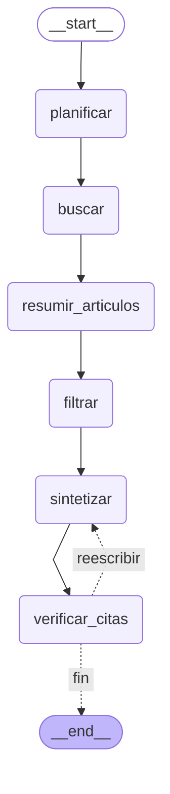

# El grafo de `litmar revisar`

El flujo de revisión de `src/litmar/flujo.py`: seis pasos fijos que comparten
un estado (`EstadoRevision`). Tres llaman al modelo de lenguaje (**LLM**) y tres
son código normal (**CÓDIGO**). Es el diagrama de la diapositiva 18 de la
Clase 2.

```mermaid
flowchart LR
    START([START]) --> planificar
    planificar["<b>LLM</b><br/>planificar<br/><i>Convierte la pregunta en 2-3 búsquedas</i>"] --> buscar
    buscar["<b>CÓDIGO</b><br/>buscar<br/><i>Consulta las fuentes</i>"] --> resumir_articulos
    resumir_articulos["<b>LLM</b><br/>resumir_articulos<br/><i>Puntúa la relevancia de los candidatos</i>"] --> filtrar
    filtrar["<b>CÓDIGO</b><br/>filtrar<br/><i>Selecciona los N con mejor puntuación</i>"] --> sintetizar
    sintetizar["<b>LLM</b><br/>sintetizar<br/><i>Escribe la síntesis citando por DOI</i>"] --> verificar_citas
    verificar_citas["<b>CÓDIGO</b><br/>verificar_citas<br/><i>¿Cada DOI citado está entre los seleccionados?</i>"]
    verificar_citas -- "citas inventadas: reescribir (máx. 2)" --> sintetizar
    verificar_citas -- "ok" --> END([END])

    classDef llm fill:#141414,color:#ffffff,stroke:#e8f33d,stroke-width:2px
    classDef codigo fill:#ececec,color:#141414,stroke:#bbbbbb
    class planificar,resumir_articulos,sintetizar llm
    class buscar,filtrar,verificar_citas codigo
```



| Nodo | Tipo | Lee del estado | Escribe en el estado |
| --- | --- | --- | --- |
| `planificar` | LLM | `question` | `queries` (2-3; el código recorta a `MAX_CONSULTAS` = 3) |
| `buscar` | CÓDIGO | `queries` | `articles` (sin duplicados), `warnings` si falla una fuente |
| `resumir_articulos` | LLM | `articles`, `question` | `summaries` (DOI → `ResumenArticulo`), `warnings` |
| `filtrar` | CÓDIGO | `articles`, `summaries` | `selected`: los N con mejor puntuación combinada (máx. `MAX_SELECCIONADOS` = 10) |
| `sintetizar` | LLM | `summaries`, y al reescribir `report` e `invalid` | `report`, `rewrites` |
| `verificar_citas` | CÓDIGO | `report`, `selected`, `rewrites` | `cited`, `invalid`; tras `MAX_REESCRITURAS` = 2, `unverified` y el informe marcado |

La puntuación combina relevancia (70 %) y una puntuación de citas anualizadas
(30 %). Si el recuento no está disponible, usa solo la relevancia y lo señala
en los avisos. La arista condicional (`decidir`) vuelve a `sintetizar` si hay
DOI inventados y quedan reescrituras; si no, termina. Las decisiones están en
`DECISIONS.md` (D-18 y D-23).

## Generado desde el código

LangGraph dibuja el grafo compilado. Este diagrama es la prueba de que el
código coincide con el de arriba; `tests/test_flujo.py` falla si deja de estar
al día. Para regenerarlo:

```bash
uv run python -c "from litmar.flujo import crear_flujo; print(crear_flujo(None).get_graph().draw_mermaid())"
```


